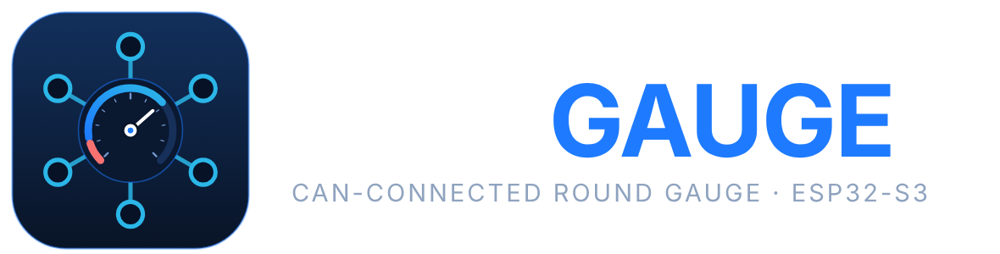

<p align="center">
  <picture>
    <source media="(prefers-color-scheme: dark)" srcset="Docs/images/can-gauge-logo-dark.png">
    <source media="(prefers-color-scheme: light)" srcset="Docs/images/can-gauge-logo-light.png">
    
  </picture>
</p>

<p align="center">
  <b>A round display that reads a 0-5 V sensor, shows it, and sends it on the CAN bus.<br>
  Configured and updated over CAN, no cable, no recompiling.</b>
</p>

<p align="center">
  
  
  
  
  
</p>

CAN_GAUGE is a small custom board (ESP32-S3 + 1.85" round display) built for
my BMW E36 race car. The fuel tank is in the boot, behind a foam baffle, so it
is hard to know how much fuel is left: the board is fixed **on the inside of a
window** and read from outside.

It measures a classic 0-5 V sensor (a fuel float, but any 0-5 V sensor works),
turns the voltage into a real value with a calibration table, checks the
sensor, raises alarms, and puts the value on the CAN bus for the other
boards of the car. All the settings can be changed from a PC with
[BusWrench](https://github.com/nicola-reat/BusWrench), and the firmware itself
is updated **over CAN**.

> Several gauges can live on the same bus (fuel, oil pressure, ...): every
> board has its own node ID.

## Features

- **Analog input 0-5 V**: 64 samples averaged for each reading, then a moving
  average (50 ms to 10 s, default 1 s) so the needle does not jump.
- **Calibration table**: 2 to 16 points (voltage → value), with linear
  interpolation. It also works the other way round (full tank = low voltage).
- **Sensor supervision**: wire cut, short to ground and short to 5 V are
  detected and reported (limits are adjustable). A fault is started and ended
  only after half a second of stable readings, so a spike does not trigger it.
- **Alarms**: low, very low and high, each with enable, threshold, hysteresis
  and delay, plus an "ignore for the first seconds after power on" time. During
  a sensor fault all alarms are off.
- **Round display** 1.85" (360 × 360, ST77916) with a UI designed in SquareLine
  Studio and drawn by LVGL.
- **CAN bus** at 500 kbit/s: the value is sent every 100 ms by default
  (20 to 500 ms), together with the voltage, the alarm flags and a frame counter.
- **Configuration over CAN**: filter, fault limits, calibration table, name,
  unit, decimals, behaviour on fault, alarms, frame period and node ID. Values
  work at once and can be saved in the permanent memory (NVS) or reset to the
  factory values.
- **Firmware update over CAN** with 256-byte blocks, an acknowledgement for each
  block, retries and a CRC32 check of the whole image. Two OTA partitions: the
  running firmware is never touched, and if the new one does not start the
  board **rolls back by itself**.
- **Diagnostics**: uptime, reset reason, CAN error counters, flash partitions
  and git commit of the running firmware, readable from the PC.
- **Remote actions**: reboot, identify (the display blinks to find the right
  board among several) and manual rollback.

## Hardware

| | |
|---|---|
| MCU | ESP32-S3-WROOM-1-N, 8 MB flash, 8 MB PSRAM |
| Display | 1.85" round LCD, 360 × 360, ST77916 (connector compatible with the Waveshare ESP32-S3-AUDIO-Board display, touch not used) |
| Sensor input | 0-5 V on an ADC channel, through a voltage divider (GPIO4) |
| CAN | on-board transceiver, 500 kbit/s, switchable termination (TX GPIO48, RX GPIO47) |
| Power | 12 V from the car, with protection, 12 V → 5 V buck converter (LV3842) |
| Programming | USB-C (with auto-reset) for the first flash; then CAN |
| Connector | 8-way Molex: sensor signal, 5 V for the sensor, GND, ignition, CAN L, CAN H, +12 V |

In this revision the input is a classic 0-5 V sensor (no NTC) and the ignition
input is not used by the firmware yet.

The schematic and the PCB are in [`PCB/`](PCB), the enclosure in
[`3D/Case`](3D/Case).

## Part of a bigger system

CAN_GAUGE is one of the boards of the car and it is managed by BusWrench:

| Project | What it is |
|---------|-----------|
| **CAN_GAUGE** (this repository) | Gauge with a round display and one analog input |
| [**BusWrench**](https://github.com/nicola-reat/BusWrench) | Windows app: bus scan, firmware update over CAN, configuration of the boards |
| [**CAN_PDM**](https://github.com/nicola-reat/can_pdm) | Power distribution module (STM32F446) |

## How it talks on the bus

Standard 11-bit frames, little endian. The board has a node ID (default `0x45`,
changeable from BusWrench, 1 to `0x7F`) and the IDs are derived from it:

| ID | Direction | Content |
|----|-----------|---------|
| `0x500 + node` | board → all | **Sensor value**, sent by itself every 100 ms |
| `0x600` | PC → all | Broadcast, only `SCAN` is accepted |
| `0x600 + node` | PC → board | Commands |
| `0x680 + node` | board → PC | Replies and heartbeat (every second) |
| `0x700 + node` | PC → board | File data during an update |

**Sensor frame (`0x500 + node`, 6 bytes)**

| Byte | Content |
|------|---------|
| 0-1 | value × 10 (i16). `FF FF` = no valid value yet |
| 2-3 | voltage at the connector, mV (u16) |
| 4 | flags: bit 0 sensor fault, bit 1 low alarm, bit 2 high alarm, bit 3 very low alarm |
| 5 | frame counter (0..255), it stops if the board stops |

Example: `0x545  C8 00  D0 07  00  2A` = 20.0, 2000 mV, no alarms, frame 42.

The full protocol (update sequence, details, parameters) is documented in the
[BusWrench README](https://github.com/nicola-reat/BusWrench#how-it-works) and
defined in [`FW/CanGauge/main/can_update_proto.h`](FW/CanGauge/main/can_update_proto.h).
A DBC file for [SavvyCAN](https://www.savvycan.com/) is in
[`FW/can_update.dbc`](FW/can_update.dbc).

## Configuration with BusWrench

Connect a PEAK PCAN-USB to the bus, open BusWrench, scan, select the gauge and
open **Configurazione**:

- **Sensore**: calibration table with a curve graph (drag the points, or
  "capture" the live voltage), filter time and fault limits, live value.
- **Display**: name, unit, decimals, and what to show on a fault (`- - -` or the
  last valid value).
- **Allarmi**: three alarms with threshold, hysteresis and delay, and the live
  state read from the board.
- **CAN**: node ID, period of the sensor frame, and a live view of the frame
  byte by byte.

**Invia alla scheda** applies the values at once, **Salva sulla scheda** keeps them
after a power off, **Fabbrica** restores the factory values.

| Parameter | Default |
|-----------|---------|
| Name / unit | `FUEL` / `L` |
| Decimals | 1 |
| Filter | 1000 ms |
| Fault limits | below 250 mV or above 4600 mV |
| Sensor frame period | 100 ms |
| Low alarm | 12.0, on |
| Very low alarm | 6.0, on |
| High alarm | 60.0, off |
| Hysteresis / delay | 1.0 / 2.0 s |
| Ignore alarms after power on | 5 s |
| Node ID | `0x45` |

The calibration table of a new board holds **example values**: measure your own
tank (known liters → voltage) and write the real points.

## Firmware

**Requirements**
- [ESP-IDF](https://docs.espressif.com/projects/esp-idf/en/stable/esp32s3/get-started/) 5.5
- The board connected by USB-C

**Build and first flash**

```bash
cd FW/CanGauge
idf.py set-target esp32s3
idf.py build
idf.py -p COMx flash monitor
```

`sdkconfig.defaults` already holds the settings of the project (8 MB flash,
the two OTA partitions of `partitions.csv`, application rollback, LVGL fonts).
The file `sdkconfig` is generated and is not in git.

**Next updates: over CAN**

1. `idf.py build` produces `build/CanGauge.bin`.
2. In BusWrench: **Scansiona**, select the board, **Aggiorna Firmware**, choose
   the `.bin` and **Avvia Aggiornamento**.
3. The board restarts on the new firmware. If the new firmware does not
   confirm itself, the bootloader goes back to the previous one.

The version is set by `PROJECT_VER` in `FW/CanGauge/CMakeLists.txt`.

**Flash layout (8 MB)**

| Partition | Address | Size |
|-----------|---------|------|
| nvs | `0x9000` | 24 KB |
| otadata | `0xF000` | 8 KB |
| phy_init | `0x11000` | 4 KB |
| ota_0 | `0x20000` | 3.5 MB |
| ota_1 | `0x3A0000` | 3.5 MB |

## Project structure

```
PCB/                       Schematic and PCB
3D/Case/                   Enclosure
Docs/                      Documents and images
FW/
├── can_update.dbc         DBC file for SavvyCAN
└── CanGauge/              ESP-IDF project
    ├── main/
    │   ├── main.c             start-up, firmware confirmation
    │   ├── can_node.c         CAN protocol: scan, update, parameters, sensor frame
    │   ├── can_update_proto.h CAN IDs and codes (shared with BusWrench)
    │   ├── adc_sensor.c       ADC, filter, fault detection, calibration table
    │   ├── gauge_cfg.c        name, unit, decimals, fault mode, frame period
    │   └── gauge_alarm.c      alarms
    ├── components/
    │   ├── lcd_st77916/       display driver
    │   └── ui/                SquareLine Studio user interface (generated)
    ├── partitions.csv
    └── sdkconfig.defaults
```

The files of `components/ui` are generated by SquareLine Studio and are
overwritten at every export: custom display code lives in `main/`.

## Roadmap

- [x] Power supply, CAN interface, analog front-end, ESP32-S3 and display
- [x] 0-5 V sensor: filter, calibration table, fault detection
- [x] Sensor frame on the CAN bus
- [x] Configuration of everything over CAN (BusWrench)
- [x] Alarms with threshold, hysteresis, delay and start-up time
- [x] Firmware update over CAN with automatic rollback
- [x] Diagnostics, reboot, identify, rollback
- [ ] Live value, name, unit and alarms on the display (the UI is still static)
- [ ] Sensor frame and parameters in the DBC file
- [ ] Gallery: photos, screenshots and renders
- [ ] Enclosure
- [ ] Ignition input
- [ ] Optional: value taken from another gauge over CAN

## Contributing

Issues and pull requests are welcome, especially for the protocol, the display
UI and the enclosure.

## License

See [`LICENSE`](LICENSE).
